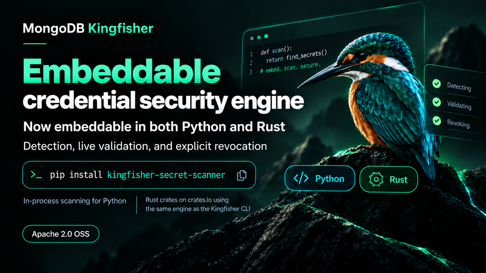
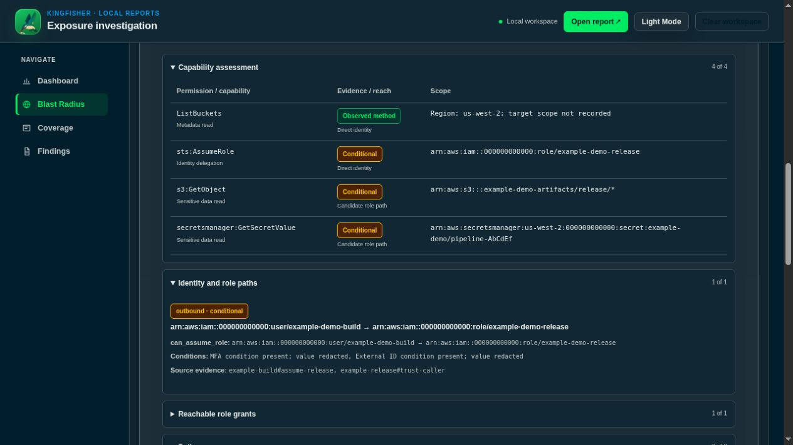

# Detect and Validate Secrets Anywhere. Map Access. Revoke Fast.

<p align="center">
  
  <br>
  <a href="https://opensource.org/licenses/Apache-2.0">
    
  </a>
  <a href="https://github.com/mongodb/kingfisher/pkgs/container/kingfisher">
    
  </a>
  <br>
  <a href="https://github.com/mongodb/kingfisher/releases">
    
  </a>
  <a href="https://pypi.org/project/kingfisher-bin/">
    
  </a>
</p>

**Find leaked secrets. Validate what’s live. Map the blast radius. Revoke fast.**

Kingfisher is a fast, free, open-source secret scanner and credential response tool built in Rust. It detects leaked secrets with [hundreds of built-in rules](https://mongodb.github.io/kingfisher/rules/builtin-rules/), validates which credentials are active, maps access for supported credential types, and revokes supported secrets—all in one Apache-2.0-licensed release:

**Detect → Validate → Map → Triage → Revoke**

 - scan source code, Git history, cloud storage, container images, archives, and developer platforms
 - validate which credentials are active
 - map a leaked secret's identity, permissions, and reachable resources
 - triage findings in a browser, or output as SARIF, JSON, TOON
 - revoke supported secrets

> **Defender workflow:** Follow the [end-to-end defender workflow](docs/DEFENDER_WORKFLOW.md) for secret detection, validation, notifications, blast-radius mapping, and revocation.

## Embed Kingfisher in Rust or Python

Add Kingfisher's fast secret scanning, live credential validation, and revocation
to your own applications through a Python module or native Rust library.
Everything runs in-process, with no CLI subprocess required.

<p align="center">
  
</p>

- **Python:** Install `uv add kingfisher-secret-scanner` and import `kingfisher_sdk`.
  See the [Python SDK guide](docs/PYPI.md) and [runnable examples](python/examples)
  for scanning, validation, rule inspection, and explicit revocation.
- **Rust:** Use `kingfisher-scanner`. See the [library guide](docs/LIBRARY.md) and
  [runnable examples](crates/kingfisher-scanner/examples) for scanning and validation,
  plus [revocation via `kingfisher-scanner`](docs/LIBRARY.md#revoke-a-credential).

## Scan Targets

Kingfisher handles local files and directories, Git repositories and history, compressed and
office-document archives, SQLite databases, Python bytecode, Docker images, source-hosting
organizations, cloud object storage, collaboration tools, and API-development platforms.

<div align="center">

| Files / Dirs | Local Git | GitHub | GitLab | Azure Repos | Bitbucket | Gitea | Hugging Face |
|:-------------:|:----------:|:------:|:------:|:-------------:|:----------:|:------:|:-------------:|
| <br/><sub>Files / Dirs</sub> | <br/><sub>Local Git</sub> | <br/><sub>GitHub</sub> | <br/><sub>GitLab</sub> | <br/><sub>Azure Repos</sub> | <br/><sub>Bitbucket</sub> | <br/><sub>Gitea</sub> | <br/><sub>Hugging Face</sub> |

| Docker | Jira | Confluence | Slack | Teams | Postman | AWS S3 | Google Cloud | Azure Blob Storage |
|:------:|:----:|:-----------:|:-----:|:-----:|:-------:|:------:|:------------:|:------------------:|
| <br/><sub>Docker</sub> | <br/><sub>Jira</sub> | <br/><sub>Confluence</sub> | <br/><sub>Slack</sub> | <br/><sub>Teams</sub> | <br/><sub>Postman</sub> | <br/><sub>AWS&nbsp;S3</sub> | <br/><sub>Cloud Storage</sub> | <br/><sub>Azure Blob Storage</sub> |

</div>

For target-specific commands, authentication, scope, and pagination behavior, use the
[platform integration guide](docs/INTEGRATIONS.md).

## Discover, validate, and revoke — open source options

All four tools detect secrets. Kingfisher and Betterleaks 2.0 RC1 also include
credential revocation for supported providers.

| Built-in capability | Kingfisher | Betterleaks 2.0 RC1 | TruffleHog OSS | Gitleaks |
|---|:---:|:---:|:---:|:---:|
| (Find) Secret discovery | ✅ | ✅ | ✅ | ✅ |
| (Validate) Live credential verification | ✅ | ✅ | ✅ | ❌ |
| (Revoke) **Credential revocation** | **✅** | **✅** | ❌ | ❌ |
| License | Apache-2.0 | MIT | AGPL-3.0 | MIT |

✅ Built in · ❌ Not supported as a built-in capability.

### Blast-radius mapping: Kingfisher vs. TruffleHog OSS

Both tools provide built-in analysis for major developer, collaboration, and AI services.
Kingfisher also includes cloud IAM mapping and the additional inventory scopes below.

| Built-in mapping scope | Kingfisher | TruffleHog OSS |
|---|:---:|:---:|
| **GitHub, GitLab, Bitbucket** identity and repository access | ✅ | ✅ |
| **Slack** workspace identity and OAuth scopes | ✅ | ✅ |
| **Stripe, Shopify** account/store and API access | ✅ | ✅ |
| **Hugging Face, OpenAI, Anthropic** key/resource access | ✅ | ✅ |
| **AWS** IAM policies and role paths | ✅ | — |
| **GCP** IAM hierarchy and service-account paths | ✅ | — |
| **Azure** Graph/ARM RBAC | ✅ | — |
| **Salesforce** object/system permissions; **Auth0** scopes, applications, APIs | ✅ | — |
| **MongoDB** roles/databases/collections; **OpenAI admin** project keys, service accounts, users | ✅ | — |
| **Terraform** workspaces; **Buildkite** pipelines; **Artifactory** user/groups/repos; **Gitea** repos; **Harness** projects | ✅ | — |
| **IBM Cloud** key/account/service instances; **PayPal** scopes/account/environment | ✅ | — |

✅ Built-in mapping for the named scope · — No equivalent dedicated mapper in the reviewed OSS source.

Kingfisher includes AWS, GCP, and Azure IAM blast-radius mapping. The reviewed TruffleHog OSS
version has no dedicated IAM mapper for these clouds; it does validate their credentials and return
metadata. Shared support can differ in depth.
[Comparison and reviewed source (2026-10-22)](docs/COMPARISON.md#blast-radius-mapping-kingfisher-vs-trufflehog-oss).

## Built for Speed and Accuracy

Kingfisher's multithreaded Vectorscan engine recorded the lowest runtime on every repository in the published benchmark suite, from small projects through the Linux kernel and GitLab monorepo.
Lower runtimes are better.

<p align="center">
  
</p>

See the [benchmarks](docs/COMPARISON.md) for validation results, network-request counts, and
the test environment, and [deployment options](docs/DEPLOYMENT.md) for local, CI, and embedded use.

## Why Kingfisher

| Stage | What Kingfisher provides | Learn more |
|---|---|---|
| **Detect** | A blazingly fast, multithreaded Vectorscan regex engine combines SIMD-accelerated matching with language-aware verification across repositories, files, archives, cloud storage, containers, and developer platforms | [Scanning](docs/USAGE.md), [integrations](docs/INTEGRATIONS.md), [benchmarks](docs/COMPARISON.md) |
| **Validate** | Live provider checks that distinguish active credentials from static candidates | [Validation and filtering](docs/USAGE.md#display-only-secrets-confirmed-active-by-third-party-apis) |
| **Map** | Read-only blast-radius analysis for supported providers, including AWS role and GCP service-account reachability, bounded Bedrock discovery, and Google API-key probes | [Blast radius](docs/BLAST_RADIUS.md) |
| **Triage** | A local and hosted browser viewer for filtering, deduplication, prioritization, blast-radius inspection, and export | [Viewer usage](docs/USAGE.md#report-viewer-local-and-hosted), [hosted guide](https://mongodb.github.io/kingfisher/features/report-viewer/) |
| **Revoke** | Conservative provider-specific containment workflows for supported credentials | [Revocation](docs/REVOCATION_PROVIDERS.md) |

Live validation, advanced cloud blast-radius analysis, visual triage,
and supported revocation all ship in the free, open source Kingfisher. There is no separate paid or
enterprise tier.

Examples for different targets (replace credential placeholders with values from your secret store):

```bash
# Local files or a repository, including its Git history
kingfisher scan /path/to/code --format json

# Working tree only, without live credential checks
kingfisher scan /path/to/code \
    --git-history none \
    --no-validate \
    --format json

# Staged changes, archives, or office documents
kingfisher scan . \
    --staged \
    --format json
kingfisher scan backup.tar.gz credentials.xlsx --format json

# Remote Git repository; private GitHub repositories use KF_GITHUB_TOKEN
KF_GITHUB_TOKEN="..." \
    kingfisher scan https://github.com/my-org/my-repo.git --format json

# GitHub organization, or a user's repositories and gist history
KF_GITHUB_TOKEN="..." \
    kingfisher scan github \
        --organization my-org \
        --format json
KF_GITHUB_TOKEN="..." \
    kingfisher scan github \
        --user alice \
        --include-gists \
        --format json

# GitLab group, including subgroups and snippets
KF_GITLAB_TOKEN="..." \
    kingfisher scan gitlab \
        --group my-group \
        --include-subgroups \
        --include-snippets \
        --format json

# Azure DevOps repositories
KF_AZURE_TOKEN="..." \
    kingfisher scan azure \
        --azure-organization my-org \
        --format json

# Bitbucket workspace and snippets
KF_BITBUCKET_TOKEN="..." \
    kingfisher scan bitbucket \
        --workspace my-team \
        --include-snippets \
        --format json

# Gitea organization; private clones may also need KF_GITEA_USERNAME
KF_GITEA_TOKEN="..." KF_GITEA_USERNAME="scanner" \
    kingfisher scan gitea \
        --organization my-org \
        --format json

# Hugging Face repositories and buckets visible to an organization
KF_HUGGINGFACE_TOKEN="..." \
    kingfisher scan huggingface \
        --huggingface-organization my-org \
        --format json

# Hugging Face bucket: selected paths, with reusable content and listing checkpoints
KF_HUGGINGFACE_TOKEN="..." \
    kingfisher scan huggingface \
        --huggingface-bucket hf://buckets/my-org/data \
        --path-prefix configs/ \
        --file-extension env \
        --object-cache-dir ./object-cache \
        --format json

# AWS S3 using a local profile (public buckets can be scanned without credentials)
kingfisher scan s3 my-bucket \
    --profile security \
    --path-prefix configs/ \
    --format json

# AWS S3 using explicit credentials; add KF_AWS_SESSION_TOKEN for temporary credentials
KF_AWS_KEY="..." KF_AWS_SECRET="..." \
    kingfisher scan s3 my-bucket --format json

# Google Cloud Storage using a service-account file (also supports default credentials)
GOOGLE_APPLICATION_CREDENTIALS="/path/to/service-account.json" \
    kingfisher scan gcs my-bucket --format json

# Azure Blob Storage: container URL and a SAS token with read/list permission
KF_AZURE_STORAGE_SAS="sv=...&sp=rl&sig=..." \
    kingfisher scan azure-blob https://myaccount.blob.core.windows.net/my-container \
        --path-prefix configs/ \
        --skip-path-prefix configs/generated/ \
        --file-extension env \
        --object-cache-dir ./object-cache \
        --format json

# Container image from a registry, or a saved image archive; private registries use KF_DOCKER_TOKEN="user:password"
kingfisher scan docker ghcr.io/owasp/wrongsecrets/wrongsecrets-master:latest-master --format json
kingfisher scan docker \
    --archive image.tar \
    --format json

# Jira Cloud issues and comments; omit KF_JIRA_USER for a server bearer token
KF_JIRA_USER="user@example.com" KF_JIRA_TOKEN="..." \
    kingfisher scan jira \
        --url https://example.atlassian.net \
        --jql "updated >= -30d" \
        --skip-project ARCHIVE \
        --include-comments \
        --format json

# Confluence Cloud pages; omit KF_CONFLUENCE_USER for a server bearer token
KF_CONFLUENCE_USER="user@example.com" KF_CONFLUENCE_TOKEN="..." \
    kingfisher scan confluence \
        --url https://example.atlassian.net/wiki \
        --cql 'space = "ENG"' \
        --format json

# Slack messages and files, or Microsoft Teams messages
KF_SLACK_TOKEN="..." \
    kingfisher scan slack "api_key OR password" --format json
KF_TEAMS_TOKEN="..." \
    kingfisher scan teams "api_key OR password" --format json

# Postman collections and environments in a workspace
KF_POSTMAN_TOKEN="..." \
    kingfisher scan postman \
        --workspace my-workspace-id \
        --format json
```

See [usage](docs/USAGE.md) for the full command reference and
[integrations](docs/INTEGRATIONS.md) for platform-specific examples, including Azure Blob Storage,
GitLab, Azure DevOps, Gitea, Slack, and Jira.

See Kingfisher in action with [basic scan and validation examples](docs/USAGE.md#basic-examples),
the [end-to-end defender workflow](docs/DEFENDER_WORKFLOW.md),
[platform-specific scan examples](docs/INTEGRATIONS.md),
[blast-radius examples](docs/BLAST_RADIUS.md#standalone-flow),
[direct revocation](docs/USAGE.md#direct-secret-revocation-with-kingfisher-revoke), and
[CI and pre-commit deployment](docs/DEPLOYMENT.md#ci-and-pre-commit).

## Map the Blast Radius. Revoke the Credential.

For supported credentials, `--blast-radius` goes beyond a live/inactive verdict. It maps the
credential identity, recorded permissions, candidate role or service-account paths, and resource
scopes. This includes AWS role-assumption and GCP service-account impersonation analysis,
bounded Bedrock model discovery and availability checks, and exact read methods accepted by a
bounded Google API-key probe allowlist.

The HTML triager opens directly into an investigation workspace. Review active credentials and
coverage gaps, then trace each identity to policy evidence, candidate privilege paths, and recorded
resources. AWS, GCP, and Azure mappings are included in the open-source release.


*A 10-second walkthrough of actual viewer screens using synthetic data. Prefer a still image?
Open the [policy investigation](docs/assets/screenshots/blast-radius-investigation.jpg) or
[resource map](docs/assets/screenshots/blast-radius-map.jpg).*

The Blast Radius view separates observed API access from policy grants and conditional paths.
Search evidence, filter providers, or switch to the resource map. Risk explanations and coverage
gaps are included automatically using the same API results. Use `--aws-region` or
`--gcp-project` to expand discovery.
Existing report formats and legacy severity fields remain supported.



*Screenshots use a [synthetic, credential-free report](docs/viewer/investigation-demo.json).
See the [triager workflow](docs/USAGE.md#report-viewer-local-and-hosted) and
[collection limits](docs/BLAST_RADIUS.md#risk-and-coverage).*

Kingfisher also provides explicit, defender-led revocation for supported credentials. Revocation
is opt-in and is exposed only where Kingfisher has a bounded provider workflow; responders should
always confirm the target and operational impact before containment.

### Performance, Accuracy, and Extensible Rules
- **Performance**: multithreaded, Hyperscan‑powered scanning built for huge codebases  
- **Extensible rules**: [Betterleaks](https://github.com/betterleaks/betterleaks/blob/main/config/betterleaks.toml) is the main catalog, with selected [Veles detectors](https://github.com/google/osv-scalibr/tree/main/veles/secrets) filling gaps;
  both Betterleaks TOML (`.toml`) and the Kingfisher rule format (`.yml`/`.yaml`) are fully supported via `--rules-path` ([built-in rules](https://mongodb.github.io/kingfisher/rules/builtin-rules/), [docs/RULES.md](docs/RULES.md))
- **Validation and defender-led revocation**: validate discovered credentials live, then revoke supported credentials from the CLI. For supported provider flows, responders can contain a leaked token even when its owner is unknown or has left the company ([docs/USAGE.md](docs/USAGE.md), [docs/REVOCATION_PROVIDERS.md](docs/REVOCATION_PROVIDERS.md))
- **Blast-radius mapping in the open-source release**: use `--blast-radius` (alias `--access-map`) to map supported credentials to identities, permissions, candidate role/service-account paths, and resource scopes. All 43 providers—including AWS IAM, GCP hierarchy/impersonation, and Azure Graph/ARM RBAC mapping—are included in the Apache-2.0 release ([blast-radius docs](https://mongodb.github.io/kingfisher/features/blast-radius/))
- **Broad provider coverage**: detect and validate credentials across cloud, AI, developer tooling, databases, SaaS, messaging, identity, and cryptographic systems through the Betterleaks- and Veles-based candidate catalog
- **Compressed Files**: Supports extracting and scanning compressed files for secrets, including `tar.gz`/`bz2`/`xz`, ZIP-family containers (`zip`, `jar`, `docx`, `xlsx`, `pptx`, `odt`, `epub`, `hwpx`, and more), `asar`, HWP (Hancom OLE2/CFBF binary with DEFLATE/zlib stream decoding), and EGG (ALZip; raw-byte scanning)
- **SQLite Database Scanning**: Automatically extracts and scans SQLite database contents for secrets stored in table rows
- **PDF Text Scanning**: Extracts page text from PDFs, including Git history and archive members, with decompression/output limits; no OCR or password-protected PDF support
- **Python Bytecode (.pyc) Scanning**: Extracts and scans string constants from compiled Python (`.pyc`, `.pyo`) files
- **Baseline management**: generate and track baselines to suppress known secrets ([docs/BASELINE.md](docs/BASELINE.md))
- **Checksum-aware custom detection**: Kingfisher custom rules can verify token checksums offline before validation ([checksum intelligence](docs/RULES.md#checksum-intelligence))
- **Report Viewer (local + hosted)**: Visualize and triage Kingfisher, **SARIF, Gitleaks, and TruffleHog** output locally with `kingfisher view ./report.json` or online with the [hosted viewer](https://mongodb.github.io/kingfisher/viewer/). Multiple files, directories, and imported third-party reports are merged and deduplicated. See [docs/USAGE.md](docs/USAGE.md#report-viewer-local-and-hosted).
- **Audit reporting**: Generate compliance-oriented HTML reports with scan metadata and validation ordering
- **Embedding**: Scan in-process from [Rust](docs/LIBRARY.md) or [Python](docs/PYPI.md), with explicit validation and revocation APIs

## Basic Usage Demo
```bash
kingfisher scan /path/to/scan --view-report
```
NOTE: Replay has been slowed down for demo


# Getting Started

## Quick Start

Install with your preferred package manager:

```bash
# Homebrew (macOS/Linux)
brew install kingfisher

# PyPI wrapper
uv tool install kingfisher-bin
```

See the [full installation guide](docs/INSTALLATION.md) for all installation methods,
installer options, and [pre-commit hook installation](docs/INSTALLATION.md#pre-commit-hooks).

The examples below use Bash syntax. Replace credential placeholders with values from your
secret store; local scans need no platform credentials. See the
[environment-variable reference](docs/INTEGRATIONS.md#environment-variables) for other authentication options.

Then scan a repository, including its Git history:

```bash
kingfisher scan /path/to/repository --format json
```

Open the results in the bundled local viewer:

```bash
kingfisher scan /path/to/repository --view-report
```

### Scan files and Git history

```bash
# Clone a private GitHub repository and scan its Git history (omit the token for public repositories)
KF_GITHUB_TOKEN="..." \
    kingfisher scan https://github.com/my-org/my-repo.git --format json

# Scan checked-out files without Git history or live validation
kingfisher scan /path/to/repository \
    --git-history none \
    --no-validate \
    --format json

# Check staged changes before committing
kingfisher scan . \
    --staged \
    --format json

# Scan an archive or an office document
kingfisher scan backup.tar.gz credentials.xlsx --format json

# Focus on configuration files and skip generated content
kingfisher scan /path/to/repository \
    --path-prefix configs/ \
    --skip-path-prefix configs/generated/ \
    --file-extension env \
    --file-extension yaml \
    --format json

# Show only live credentials and map their access
kingfisher scan /path/to/repository \
    --only-valid \
    --blast-radius \
    --format json

# Include active credentials and high-confidence assumed or locally derived secrets
kingfisher scan /path/to/repository \
    --validation-filter actionable \
    --format json
```

### Save and combine reports

```bash
# Save a JSON report and open it later
kingfisher scan /path/to/repository \
    --format json \
    --output findings.json
kingfisher view findings.json

# Export SARIF for code-scanning integrations
kingfisher scan /path/to/repository \
    --format sarif \
    --output findings.sarif

# Generate a standalone HTML audit report
kingfisher scan /path/to/repository \
    --format html \
    --output audit.html

# Import and combine Kingfisher, Gitleaks, and TruffleHog reports
kingfisher view findings.json gitleaks.json trufflehog.jsonl

# Load every supported report in a directory
kingfisher view ./reports/
```

### Scan source-hosting organizations

Use a token with read access to the repositories you want to scan. See the
[integration guide](docs/INTEGRATIONS.md) for provider-specific permissions and self-hosted endpoints.

```bash
# GitHub organization
KF_GITHUB_TOKEN="..." \
    kingfisher scan github \
        --organization my-org \
        --format json
# GitHub user and their gist history
KF_GITHUB_TOKEN="..." \
    kingfisher scan github \
        --user alice \
        --include-gists \
        --format json

# GitLab group, including nested subgroups
KF_GITLAB_TOKEN="..." \
    kingfisher scan gitlab \
        --group my-group \
        --include-subgroups \
        --include-snippets \
        --format json

# Azure Repos organization
KF_AZURE_TOKEN="..." \
    kingfisher scan azure \
        --azure-organization my-org \
        --format json

# Bitbucket workspace
KF_BITBUCKET_TOKEN="..." \
    kingfisher scan bitbucket \
        --workspace my-team \
        --include-snippets \
        --format json

# Gitea organization
KF_GITEA_TOKEN="..." KF_GITEA_USERNAME="scanner" \
    kingfisher scan gitea \
        --organization my-org \
        --format json

# Hugging Face organization
KF_HUGGINGFACE_TOKEN="..." \
    kingfisher scan huggingface \
        --huggingface-organization my-org \
        --format json

# Preview the GitHub repository scope without scanning
KF_GITHUB_TOKEN="..." \
    kingfisher scan github \
        --organization my-org \
        --list-only
```

### Scan cloud storage

For S3 and GCS, use a bucket name without `s3://` or `gs://`. Azure Blob uses a full
container URL. Use `--path-prefix` to select object names; S3 and GCS also accept
the existing `--prefix` option. Omit prefix selection to scan the whole bucket or container.

```bash
# AWS S3: whole bucket with explicit credentials
KF_AWS_KEY="..." KF_AWS_SECRET="..." \
    kingfisher scan s3 my-bucket --format json

# AWS S3: temporary credentials also require the session token
KF_AWS_KEY="..." KF_AWS_SECRET="..." KF_AWS_SESSION_TOKEN="..." \
    kingfisher scan s3 my-bucket --format json

# AWS S3: only objects under backups/production/, using a named AWS profile
kingfisher scan s3 my-bucket \
    --prefix backups/production/ \
    --profile security \
    --format json

# Google Cloud Storage: whole bucket using a service-account file
GOOGLE_APPLICATION_CREDENTIALS="/path/to/service-account.json" \
    kingfisher scan gcs my-bucket --format json

# Google Cloud Storage: only objects under exports/daily/, using existing Application Default Credentials
kingfisher scan gcs my-bucket \
    --prefix exports/daily/ \
    --format json

# Azure Blob Storage: container SAS with read (r) and list (l) permissions
KF_AZURE_STORAGE_SAS="sv=...&sp=rl&sig=..." \
    kingfisher scan azure-blob \
        https://myaccount.blob.core.windows.net/my-container --format json

# Azure Blob Storage: account-key authentication (account name is inferred for standard Azure endpoints)
KF_AZURE_STORAGE_KEY="..." \
    kingfisher scan azure-blob https://myaccount.blob.core.windows.net/my-container --format json

# Azure Blob Storage: an existing Entra access token for https://storage.azure.com/
KF_AZURE_STORAGE_TOKEN="..." \
    kingfisher scan azure-blob https://myaccount.blob.core.windows.net/my-container --format json

# Hugging Face bucket: selected paths with resumable downloads
KF_HUGGINGFACE_TOKEN="..." \
    kingfisher scan huggingface \
        --huggingface-bucket hf://buckets/my-org/data \
        --path-prefix configs/ \
        --object-cache-dir ./object-cache \
        --format json
```

Authenticate to S3 with `KF_AWS_KEY` / `KF_AWS_SECRET` or `--profile`; GCS uses Application Default
Credentials, or an explicit `--service-account /path/to/key.json`. See the [S3](docs/INTEGRATIONS.md#aws-s3) and
[GCS](docs/INTEGRATIONS.md#google-cloud-storage) guides for authentication and public-bucket examples.
Azure Blob accepts a container URL; set exactly one of the SAS, account-key, or Entra-token variables,
or omit all three for anonymous access to a public container with list/read permissions;
see the [Azure Blob guide](docs/INTEGRATIONS.md#azure-blob-storage).

Use `--path-prefix`, `--skip-path-prefix`, `--file-extension`, and `--skip-file-extension`
to select paths across local files, Git repositories, archive members, and cloud storage.
S3, GCS, Azure Blob, and Hugging Face buckets apply selection before downloading and accept
`--object-cache-dir` to resume interrupted listings and reuse unchanged content. Cached content is
rescanned so each report stays complete. Custom HTTP verification services can use
[OAuth2 password-grant authentication](docs/RULES.md#oauth2-authentication-for-http-verification-services).

### Scan containers or run Kingfisher in Docker

```bash
# Scan a registry image
kingfisher scan docker ghcr.io/owasp/wrongsecrets/wrongsecrets-master:latest-master --format json

# Pull a private registry image
KF_DOCKER_TOKEN="user:password" \
    kingfisher scan docker ghcr.io/my-org/my-image:latest --format json

# Scan an image exported with docker save
kingfisher scan docker \
    --archive image.tar \
    --format json

# Run Kingfisher against the current directory without installing it
docker run \
    --rm \
    -v "$PWD":/src \
    ghcr.io/mongodb/kingfisher:latest scan /src \
    --format json

# Run in Docker and serve the report viewer to the host
docker run \
    --rm \
    -v "$PWD":/src \
    -p 127.0.0.1:7890:7890 \
    ghcr.io/mongodb/kingfisher:latest scan /src \
    --view-report \
    --view-report-address 0.0.0.0
```

For the Docker viewer, open [localhost:7890](http://localhost:7890) in your browser.

### Scan issues, documents, and messages

Jira and Confluence Cloud API tokens require the account email as well as the token.
For server bearer tokens, omit `KF_JIRA_USER` or `KF_CONFLUENCE_USER`. See the
[integration guide](docs/INTEGRATIONS.md) for required scopes and search behavior.

```bash
# Jira Cloud: search a project and include issue comments
KF_JIRA_USER="user@example.com" KF_JIRA_TOKEN="..." \
    kingfisher scan jira \
        --url https://example.atlassian.net \
        --jql "project = SEC" \
        --include-comments \
        --format json

# Confluence Cloud: scan pages in a space
KF_CONFLUENCE_USER="user@example.com" KF_CONFLUENCE_TOKEN="..." \
    kingfisher scan confluence \
        --url https://example.atlassian.net/wiki \
        --cql 'space = "ENG"' \
        --format json

# Slack: search messages and associated files
KF_SLACK_TOKEN="..." \
    kingfisher scan slack "api_key OR password" --format json

# Microsoft Teams: search messages
KF_TEAMS_TOKEN="..." \
    kingfisher scan teams "api_key OR password" --format json

# Postman: scan a workspace's collections and environments
KF_POSTMAN_TOKEN="..." \
    kingfisher scan postman \
        --workspace my-workspace-id \
        --format json
```

### Validate or revoke a known credential

```bash
# Validate a GitHub personal access token directly
export GITHUB_PAT="..."
kingfisher validate \
    --rule github-pat "$GITHUB_PAT" \
    --format json

# Revoke that token when ready to contain the exposure
kingfisher revoke \
    --rule github-pat "$GITHUB_PAT" \
    --format json
```

See [direct validation](docs/USAGE.md#direct-secret-validation-with-kingfisher-validate) and
[supported revocation providers](docs/REVOCATION_PROVIDERS.md) for other credential types.

See the [installation guide](docs/INSTALLATION.md) for pre-built binaries, Docker, mise, Windows,
pre-commit hooks, release verification, and source builds. See the [usage guide](docs/USAGE.md) for
validation filters, output formats, scan scope, and command examples.

> Live validation and blast-radius mapping make authorized requests to provider APIs. Review the
> relevant documentation and use them only where you are authorized to inspect the target account.

## Common Workflows

| Goal | Start here |
|---|---|
| Run an end-to-end credential response | [Defender workflow](docs/DEFENDER_WORKFLOW.md) |
| Scan GitHub, GitLab, Azure Repos, Bitbucket, Gitea, Hugging Face, S3, GCS, Azure Blob Storage, Docker, Jira, Confluence, Slack, Teams, or Postman | [Platform integrations](docs/INTEGRATIONS.md) |
| Configure authentication and environment variables | [Environment-variable reference](docs/INTEGRATIONS.md#environment-variables) |
| Validate or revoke a known credential | [Direct validation](docs/USAGE.md#direct-secret-validation-with-kingfisher-validate), [revocation](docs/REVOCATION_PROVIDERS.md) |
| Map identity, permissions, and affected resources | [Blast-radius guide](docs/BLAST_RADIUS.md) |
| Run scans and inspect reports in a native workspace | [Kingfisher wizard](docs/WIZARD.md) |
| Triage one or more reports visually | [Viewer usage](docs/USAGE.md#report-viewer-local-and-hosted), [hosted guide](https://mongodb.github.io/kingfisher/features/report-viewer/) |
| Configure CI, pre-commit, or centralized scanning | [Deployment](docs/DEPLOYMENT.md), [advanced configuration](docs/ADVANCED.md) |
| Send findings to chat or webhook destinations | [Alerts](docs/ALERTS.md) |
| Produce repository coverage and audit evidence | [Repository audit log](docs/AUDIT_LOG.md) |
| Suppress existing findings without hiding new ones | [Baselines](docs/BASELINE.md) |
| Write or import custom rules | [Rule authoring](docs/RULES.md) |
| Embed the scanner in Rust or use it from Python | [Rust library](docs/LIBRARY.md), [Python SDK and distribution](docs/PYPI.md) |

## Output for People and Machines

Kingfisher supports human-readable output plus TOON, JSON, JSONL, SARIF, BSON, and HTML reports.
Use JSON for structured output in scripts and integrations:

```bash
kingfisher scan /path/to/repository \
    --format json \
    --no-update-check
```

Machine consumers should use structured validation outcomes and finding fingerprints rather than
parsing display labels. See [output and validation semantics](docs/USAGE.md),
[finding fingerprints](docs/FINGERPRINT.md), and the [full documentation index](docs/INDEX.md).

## Rust Embedding Examples

The [library guide](docs/LIBRARY.md#runnable-examples) includes runnable examples for
`kingfisher-core`, `kingfisher-rules`, `kingfisher-scanner`, and the `kingfisher-bin`
library. Copyable [integration recipes](docs/LIBRARY.md#integration-recipes-for-rust-projects-and-llm-agents)
cover file batches, private rules, async services, and scanning plus HTTP validation.
For example, from a repository checkout:

```sh
cargo run --locked -p kingfisher-scanner --example http_validation --features validation
```

## Verifying Releases

Before installing a pinned release, verify that your download came from Kingfisher's release
workflow and matches the version you requested. This catches tampered downloads and substitution
with an older genuine release, which matters when Kingfisher is your CI secrets gate.
Follow the [release verification steps](docs/INSTALLATION.md#verifying-release-artifacts).

## Documentation

- **[Documentation index](docs/INDEX.md):** task-oriented map of every user, operator, rule-author,
  and developer guide in the repository.
- **[Hosted documentation](https://mongodb.github.io/kingfisher/):** searchable rendered version.
- **[llms.txt](llms.txt):** compact machine-readable map of the documentation set.
- **[Cargo publishing](docs/PUBLISHING.md):** prepared rule bundles, provenance, and crate releases.
- **[Architecture](docs/ARCHITECTURE.md):** codebase layout and data flow.
- **[Changelog](CHANGELOG.md):** release-by-release behavior changes.

## Project

Kingfisher is used in MongoDB's production security workflows and is integrated by projects such
as [Prowler](https://prowler.com/blog/whats-new-in-prowler-july-2026),
[MegaLinter](https://megalinter.io/latest/descriptors/repository_kingfisher/),
[Osmedeus](https://github.com/j3ssie/osmedeus),
[DefectDojo](https://github.com/DefectDojo/django-DefectDojo), and
[hk](https://github.com/jdx/hk). [Weblate](https://github.com/WeblateOrg/weblate) uses its
pre-commit hook. Read more about its
[lineage, evolution, and public adoption](docs/PROJECT.md).

Contributions are welcome. See [CONTRIBUTING.md](CONTRIBUTING.md), report vulnerabilities through
[SECURITY.md](SECURITY.md), and file feature requests in
[GitHub Issues](https://github.com/mongodb/kingfisher/issues).

Kingfisher is licensed under the [Apache License 2.0](LICENSE).
