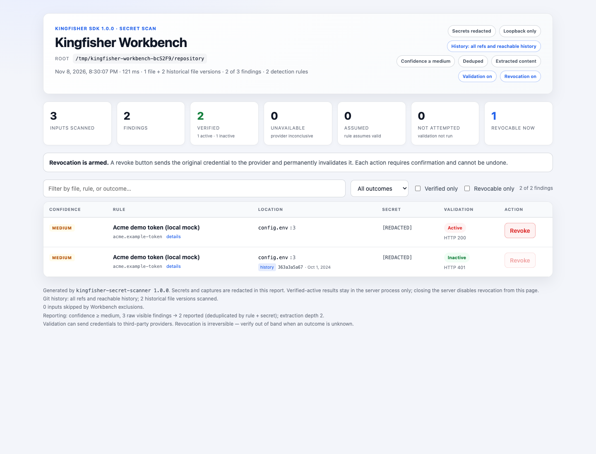

# Build Your Own Secret-Scanning Bot in Node.js — Git History Included

Delete a token from `config.env` and a scan of the working tree comes back
clean. The token is still in Git history, one `git log -p` away from anyone who
clones the repo. Off-the-shelf scanners usually make you pick a workflow, an
output format, and a place for the results to go. When you embed the scanner,
you make those choices.

The `kingfisher-secret-scanner` npm package runs the Kingfisher Rust engine
in-process through Node-API. It reads Git objects directly, with no `git`
binary required. It streams typed findings as each file finishes. It can ask
providers whether a leaked key still works. Native work runs off the event
loop, so a bot or web service keeps handling requests while it scans. It
supports ESM and CommonJS and ships TypeScript declarations. Get it on [npm](https://www.npmjs.com/package/kingfisher-secret-scanner).

<!-- more -->

## A pull request bot in under 30 lines

Install the SDK in a project on Node.js 22.13 or later:

```sh
npm install kingfisher-secret-scanner@latest
```

Save this as `pr-secret-bot.mjs`. It scans only the file versions the branch
added or changed since a base ref. It checks whether each credential still
works, then prints [GitHub Actions annotations](https://docs.github.com/en/actions/reference/workflows-and-actions/workflow-commands#setting-an-error-message)
that show up inline on the pull request diff.

```javascript
import { Scanner, Validator, gitInputs } from 'kingfisher-secret-scanner'

const base = process.argv[2] ?? 'origin/main'
const scanner = await Scanner.create()
const validator = new Validator({ timeoutMs: 5000, concurrency: 4 })
let blocking = 0

try {
  // Only the blobs this branch adds or changes since `base`.
  const changes = gitInputs('.', { mode: 'diff', refs: ['HEAD'], sinceCommit: base })
  for await (const { input, findings } of scanner.scanInputs(changes)) {
    const candidates = findings.filter(finding => finding.visible)
    if (candidates.length === 0) continue

    // Pass every finding so paired values resolve; check only the visible ones.
    for (const { finding, outcome } of await validator.validate(findings, { candidates })) {
      const { line, column } = finding.location
      const level = outcome === 'verified_inactive' ? 'warning' : 'error'
      console.log(`::${level} file=${input.path},line=${line},col=${column}::${finding.ruleId} (${outcome})`)
      if (level === 'error') blocking += 1
    }
  }
} finally {
  await Promise.all([scanner.close(), validator.close()])
}
process.exitCode = blocking > 0 ? 1 : 0
```

Wire it into a workflow. `fetch-depth: 0` gives the job the base branch to diff
against:

```yaml
on: pull_request
jobs:
  secrets:
    runs-on: ubuntu-latest
    steps:
      - uses: actions/checkout@v4
        with: { fetch-depth: 0 }
      - uses: actions/setup-node@v4
        with: { node-version: 22 }
      - run: npm install kingfisher-secret-scanner@latest
      - run: node pr-secret-bot.mjs origin/${{ github.base_ref }}
```

The policy is yours to set. This one is strict. A key the provider confirms is
dead gets a warning. Anything else blocks the merge, including a live key, an
unreachable provider, or a rule with no live check. You could just as easily
post a PR comment, open a ticket for `verified_active` findings only, or send
them to Slack.

A few things the bot gets right without extra code:

- **It scans what changed, not the whole repo.** `mode: 'diff'` yields only the
  files whose content at `HEAD` differs from `sinceCommit`, so the check stays
  fast on large repositories. To also catch a key that was added and then
  removed within the branch, switch to `mode: 'history'` with the same
  `sinceCommit`. That scans every commit the branch adds. For a pre-commit
  hook, use `'staged'`.
- **Paired credentials resolve.** Some keys only work as a pair, such as an AWS
  key ID and its secret. Passing the full `findings` batch lets the validator
  find the other half. `candidates` limits which findings get a live check.
- **Secrets stay out of the log.** The annotations carry only the rule ID and
  position. When you need a structured report, `toJSON()` redacts the secret
  and captures by default.

## Find what's still in history

A PR bot catches new leaks. To audit what has already landed, scan the working
tree and every reachable commit with the same scanner:

```javascript
import { Scanner, filesystem, gitInputs } from 'kingfisher-secret-scanner'

const root = process.argv[2] ?? '.'
const scanner = await Scanner.create()

async function report(inputs) {
  for await (const result of scanner.scanInputs(inputs)) {
    if (result.findings.some(finding => finding.visible)) {
      console.log(JSON.stringify(result.toJSON()))
    }
  }
}

try {
  await report(filesystem([root]))
  await report(gitInputs(root, { mode: 'history', refs: ['HEAD'] }))
} finally {
  await scanner.close()
}
```

Each `ScanResult` arrives as soon as its input finishes. For Git inputs, it
carries the commit and blob identifiers, so you can see where a deleted key
lives on. Set `refs: null` to walk every local branch and tag, not just `HEAD`.

The same `Scanner` works in other places too. In an editor extension, pass an
unsaved buffer straight to `scan()` and flag a key before it's ever written to
disk. In a review dashboard, call `scanFile()` on each changed file. In an upload
service, add `expandArchives()` to the input pipeline to look inside zips and
tarballs. See the [JavaScript and TypeScript SDK guide](../../reference/javascript-bindings.md).

## Why it's fast enough for every push

`Scanner.create()` compiles the built-in rules into a single
[Vectorscan](https://github.com/VectorCamp/vectorscan) database. Vectorscan
uses SIMD instructions to match every rule in one pass over the bytes. It
doesn't run a separate regex per rule. Only the candidates it finds go to Rust
regexes for capture confirmation and rule filters. Create one scanner per
process and reuse it, so you pay the compilation cost once. See the
[matching architecture](../../reference/architecture.md).

## See it all in Kingfisher Workbench

Workbench is a small Node app built on the SDK. It scans the working tree and
Git history, shows live progress, and turns results into a searchable, redacted
HTML report. Its demo creates a temporary repository with two synthetic tokens.
One is current and active. The other was removed from the working tree, still
appears in history, and comes back inactive from a local mock provider.



From `javascript/` in a checkout with the native SDK built, run the demo and
open the local URL it prints. The setup steps are in the [Workbench walkthrough](https://github.com/mongodb/kingfisher/blob/main/javascript/examples/kingfisher-workbench/README.md).

```sh
node examples/kingfisher-workbench/scripts/checkout.mjs demo
```

To try validation without contacting a real provider, run the
[local validation example](https://github.com/mongodb/kingfisher/blob/main/javascript/examples/local-workflow.mjs).
It scans a synthetic token, proves it's active against a mock server on
localhost, and can revoke it.
