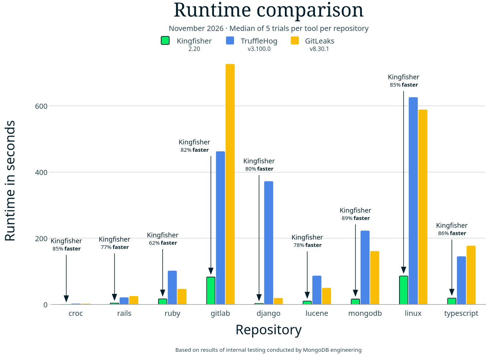

# Kingfisher Capabilities and Open-Source Comparisons

## Runtime Comparison (seconds)

Scanned November 20, 2026 using Kingfisher 2.20, TruffleHog 3.100.0, and
Gitleaks 8.30.1. Each value is the median wall-clock time of five sequential
trials over the local repositories and their available Git history. Kingfisher
and TruffleHog ran with live credential checks disabled.
Gitleaks only detects secrets. Update checks were disabled where available.
TruffleHog scanned the local clones in place. Kingfisher used its default
detection settings, including archive extraction. Tool-specific filters and Git
enumeration affect coverage. [Benchmark commands and methodology](https://github.com/mongodb/kingfisher/blob/main/docs/benchmark/README.md).

| Repository | Kingfisher | TruffleHog | Gitleaks |
|---|---:|---:|---:|
| croc | 0.36 | 2.54 | 2.35 |
| rails | 4.93 | 21.42 | 25.26 |
| ruby | 17.83 | 102.05 | 46.92 |
| gitlab | 83.96 | 462.59 | 726.61 |
| django | 3.96 | 372.25 | 19.60 |
| lucene | 11.12 | 87.03 | 50.22 |
| mongodb | 17.45 | 223.09 | 161.34 |
| linux | 86.92 | 626.05 | 588.86 |
| typescript | 20.07 | 145.31 | 177.60 |
| **Sum of medians** | **246.62** | 2042.32 | 1798.76 |

Kingfisher had the lowest median on all nine repositories.

A replacement trial after disk space was restored supplies the fifth usable
GitLab TruffleHog measurement.

TruffleHog logged localized errors while parsing Git dates and reading compressed
streams. The Linux checkout had pre-existing changes, and scanners handle working
trees and Git history differently.

### Validated/Verified Findings Comparison

These counts come from a separate run with live credential checks. Gitleaks has
no live validation, so its verified counts are **N/A**.

| Repository | Kingfisher Validated | TruffleHog Verified | Gitleaks Verified |
|------------|----------------------|---------------------|-------------------|
| croc | 0 | 0 | N/A |
| rails | 0 | 0 | N/A |
| ruby | 0 | 0 | N/A |
| gitlab | **6** | **6** | N/A |
| django | 0 | 0 | N/A |
| lucene | 0 | 0 | N/A |
| mongodb | 0 | 0 | N/A |
| linux | 0 | 0 | N/A |
| typescript | 0 | 0 | N/A |

### Network Requests Comparison

On November 20, 2026, Kingfisher 2.20 and TruffleHog 3.100.0 each scanned
each repository once with validation enabled and update checks disabled. The
scanners could reach a local counting proxy, which rejected every plain HTTP
request and HTTPS CONNECT attempt with HTTP 403. Direct connections and DNS
egress were blocked independently of the proxy.

Counts include retries that reached the proxy. Validation that stopped at a
DNS preflight or tried a direct connection falls outside this count.

| Repository | Kingfisher Proxy Attempts | TruffleHog Proxy Attempts |
|---|---:|---:|
| croc | 0 | 241 |
| rails | 0 | 18 |
| ruby | 0 | 252 |
| gitlab | 1 | 13,612 |
| django | 0 | 13 |
| lucene | 0 | 72 |
| mongodb | 0 | 3,533 |
| linux | 0 | 93 |
| typescript | 0 | 13 |
| **Total** | **1** | **17,847** |

With live credential checks, both scanners reported six verified findings
across the nine repositories. The proxy recorded 16,369 HTTP requests and HTTPS
CONNECT tunnels for TruffleHog and 22 for Kingfisher in that run.

## Benchmark Environment

Apple M4 Max, macOS 27.2 (arm64), 16 logical CPUs, 48 GiB RAM.

All four tools detect secrets. Kingfisher and Betterleaks 2.0 RC5 also include
credential revocation for supported providers.

| Built-in capability | Kingfisher | Betterleaks 2.0 RC5 | TruffleHog OSS | Gitleaks |
|---|:---:|:---:|:---:|:---:|
| Secret discovery | ✅ | ✅ | ✅ | ✅ |
| Live credential verification | ✅ | ✅ | ✅ | ❌ |
| Credential revocation | ✅ | ✅ | ❌ | ❌ |
| License | Apache-2.0 | MIT | AGPL-3.0 | MIT |

✅ Built in · ❌ Not supported as a built-in capability.

General capability references: [Betterleaks 2.0 RC7](https://github.com/betterleaks/betterleaks/blob/8f376ff9c31ed5309ac448fe601c5dd21b376155/README.md),
[TruffleHog OSS](https://github.com/trufflesecurity/trufflehog/blob/662edea3ea7987aafe71580da817e2ee4e8a8783/README.md),
and [Gitleaks](https://github.com/gitleaks/gitleaks/blob/v8.30.1/README.md).

Kingfisher also extracts PDF page text in CLI file, Git-history, and archive scans;
the SDK exposes it explicitly through `expand_content(..., pdf=True)`. This is
bounded text extraction, not OCR or encrypted-PDF support. See
[coverage and limits](../usage/advanced.md#pdf-text-extraction).
