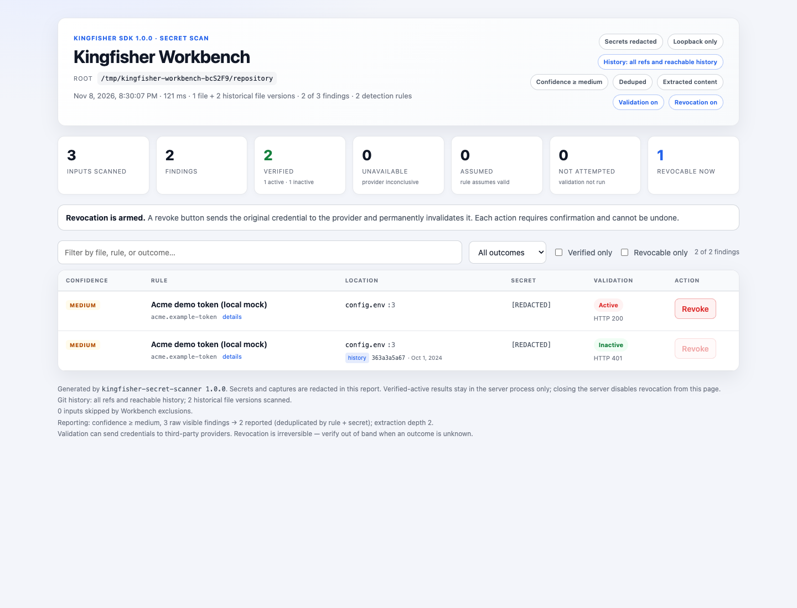

# Kingfisher for JavaScript and TypeScript

[← Back to README](../README.md)

The `kingfisher-secret-scanner` npm SDK **1.0.1** is a stable release.
It exposes Kingfisher's Rust components in-process through napi-rs and Node-API.
Install with npm and import/require `kingfisher-secret-scanner` in JavaScript. No
Python interpreter, CLI process, or separate Kingfisher installation is involved.

The SDK version is independent of the CLI, Python SDK and published Rust crate
versions. The same distribution name on **PyPI** is the separate Python SDK:
install with pip and `import kingfisher_sdk`, not the npm package. Neither SDK
distributes the CLI. See [source and examples](../javascript) and the
[Rust](LIBRARY.md) and [Python](PYPI.md) embedding guides.

## Showcase: Kingfisher Workbench

[Kingfisher Workbench](../javascript/examples/kingfisher-workbench/README.md) is a complete,
commented SDK application: working-tree and Git-history scans, live progress,
redacted HTML reports, and separately enabled validation and revocation.



From a [built checkout](#build-and-test-from-a-checkout), run
`node examples/kingfisher-workbench/scripts/checkout.mjs demo` in `javascript/` and open the printed
loopback URL. The demo creates a temporary repository and validates only synthetic
credentials against a local mock provider. Revocation requires browser confirmation
and changes mock state only. Real-repository runs default to offline detection and
redacted reports; see the app's walkthrough before enabling external operations.

## Start here: a reproducible workflow

**For an LLM/agent:** read this section, choose one recipe, check its side effects,
and run the corresponding source file. Do not infer permission for network calls,
credential disclosure, revocation, package publication, or release tags from a request to scan.

| Goal | Read/run | External effects |
| --- | --- | --- |
| Learn text, bytes and file detection | [Quickstart](../javascript/examples/quickstart.mjs) | None; synthetic local fixtures |
| Configure YAML/TOML and exact selectors | [Custom rules](../javascript/examples/custom-rules.mjs) | None |
| Bound/cancel async operations | [Controls](../javascript/examples/controlled-scan.mjs) | None |
| Scan a local project as redacted JSONL | [Project pipeline](../javascript/examples/scan-project.mjs) | Local reads and possible temporary extraction |
| Expand compressed content explicitly | [Archive pipeline](../javascript/examples/archive-content.mjs) | Synthetic local content and possible temporary extraction |
| Scan committed, historical, diff or index data | [Git scopes](../javascript/examples/git-scopes.mjs) | Read-only local repository |
| Learn validation and revocation without live credentials | [Local mock workflow](../javascript/examples/local-workflow.mjs) | Loopback HTTP; optional in-memory mock mutation |
| Scan one file with built-ins (CommonJS) | [Content](../javascript/examples/content.cjs) | Local reads only |
| Compose filesystem/archive/content stages (CommonJS) | [Inputs](../javascript/examples/inputs.cjs) | Local reads and possible temporary extraction |
| Scan a local HEAD snapshot (CommonJS) | [Git](../javascript/examples/git.cjs) | Read-only local repository |
| Inspect catalog metadata and CLI detection controls | [Rules and controls](../javascript/examples/rules-and-controls.mjs) | Offline rule loading and detection |
| Prepare trusted custom-rule operations | [Validate/revoke](../javascript/examples/validate-revoke.cjs) | Offline by default; provider requests and mutation require separate flags/authorization |
| Use TypeScript in an application | [TypeScript recipe](#typescript-application), [typed source](../javascript/examples/typed-scan.mts) | Local detection |
| Configure/release on npm | [npm publishing setup](PUBLISHING.md#npm-publishing-with-github-actions) | Explicit account changes, registry writes and release tags |

### Run the safe teaching examples before publication

First [build and test the checkout](#build-and-test-from-a-checkout) with a
[supported Node runtime](#nodejs-and-vs-code-support). Then run these commands from
`javascript/`. No npm account or real credential is required.

```sh
node examples/quickstart.mjs
node examples/custom-rules.mjs
node examples/controlled-scan.mjs
node examples/scan-project.mjs
node examples/archive-content.mjs
node examples/local-workflow.mjs
npm run test:types
node --experimental-strip-types examples/typed-scan.mts
```

The [example walkthrough](../javascript/examples/README.md) explains each command,
its inputs, output fields, success/failure signals, side effects and production adaptations.
The quickstart reports three phases with one **synthetic, redacted** finding in each.
The mock's default summary has one validation request and **zero revocations**.
These are demonstrations, not extra built-in detectors or production credentials.
The project recipe uses its teaching rule only with no arguments; supplying local
paths selects the full built-in catalog for a realistic scan.

### Adapt an example to an installed package

After publication, create an application directory and run:

```sh
npm init -y
npm install kingfisher-secret-scanner@1.0.1 --ignore-scripts
```

Use `import { Scanner } from 'kingfisher-secret-scanner'` in a `.mjs` file,
or `const { Scanner } = require('kingfisher-secret-scanner')` in a `.cjs` file.
Checkout examples use `../index.mjs` / `../index.cjs`; replace those imports when
copying them into an application and copy their fixtures too. Consumers do not
need Rust, Python, the CLI, or a local native-source build.

## Scan content

```typescript
import { Scanner } from "kingfisher-secret-scanner";

const configurationText = "ordinary application configuration";
const scanner = await Scanner.create(); // Load/compile once, then reuse.
try {
  const findings = await scanner.scan(configurationText, { path: "config.env" });
  for (const finding of findings) {
    if (finding.visible) console.log(finding.toJSON()); // Redacted by default.
  }
} finally {
  await scanner.close();
}
```

`scan()` accepts text, `Buffer`, or `Uint8Array`, including typed-array slices.
SharedArrayBuffer-backed inputs require an explicit non-shared copy, such as
`Buffer.from(sharedView)`, so concurrent worker writes cannot race native reads.
Native calls snapshot input bytes before asynchronous scanning, so later caller
mutation cannot change the submitted input. `scanFile()` reads one local file;
it does not recurse, extract archives, fetch sources, or validate credentials.
Its filename is authoritative: a `path` override is rejected, and `attributes.path`
must match that filename. Only regular files are accepted; FIFOs/devices are not
scan inputs. On Unix the opened handle is checked after a nonblocking open so a
file-to-FIFO swap cannot occupy a worker indefinitely. File reads happen in the
native worker into bounded, owned memory, with controls checked between reads.
Concurrent truncation does not invalidate native memory; the read is not an atomic
filesystem snapshot, so external writes can change the
bytes observed while reading. Individual reads and decoding remain cooperative.
An empty successful result means no matches under the selected rules, not proof
that the input contains no secrets. Errors reject rather than becoming empty scans.

### TypeScript application

**Prerequisite:** complete the [installed-package setup](#adapt-an-example-to-an-installed-package)
after publication. This minimal consumer is separate from the checkout examples.
Add the TypeScript development tools:

```sh
npm install --save-dev typescript @types/node
```

Create `tsconfig.json` at the application root:

```json
{
  "compilerOptions": {
    "target": "ES2022",
    "module": "NodeNext",
    "moduleResolution": "NodeNext",
    "types": ["node"],
    "lib": ["ES2022", "ESNext.Disposable"],
    "strict": true,
    "rootDir": "src",
    "outDir": "dist"
  },
  "include": ["src/**/*.mts"]
}
```

Create `src/scan.mts` (the `.mts` extension selects ESM):

```typescript
import { Scanner, ScanInput, type ScanResultReport } from "kingfisher-secret-scanner";

const scanner = await Scanner.create({ maxInputBytes: 16 * 1024 * 1024 });
try {
  const input = new ScanInput({ path: "config.env", data: "ordinary configuration" });
  const result = await scanner.scanInput(input, { timeoutMs: 5000 });
  const report: ScanResultReport = result.toJSON();
  console.log(JSON.stringify(report));
} finally {
  await scanner.close();
}
```

```sh
npm exec -- tsc -p tsconfig.json
node dist/scan.mjs
```

Expected: one JSON object containing `input` and `findings`; the sample normally
has `findings: []`. Replace the data with authorized input, not your compiler flags.
Native packages must remain external in bundlers and be shipped for the actual
runtime OS/CPU; do not bundle the `.node` file into a browser or edge isolate.

### Reuse a scanner in an application service

Initialize once, bound application work, and close on graceful shutdown:

```javascript
import { Scanner } from "kingfisher-secret-scanner";

const scanner = await Scanner.create({
  maxInputBytes: 16 * 1024 * 1024,
  maxPendingOperations: 4,
  dedup: false
});

export async function inspectBuffer(text, path, signal) {
  // Keep original Finding objects private; return only redacted report data.
  const findings = await scanner.scan(text, { path, signal, timeoutMs: 5000 });
  return findings.filter(f => f.visible).map(f => f.toJSON());
}

export async function closeScanner() {
  await scanner.close();
}
```

This is a module fragment, not an HTTP server. Your caller must limit concurrent
submissions, authorize inputs and invoke `closeScanner()` during shutdown.
Catch `AbortError` and `TimeoutError` **before** their `KingfisherError` base class;
never convert failures into “no secrets.” Caller callbacks retain their original
exceptions rather than being relabeled as native failures.

| Error code | Meaning / response |
| --- | --- |
| `ERR_KINGFISHER_CANCELLED` | Cooperative cancellation (`AbortError`); inspect `cause` for a signal reason |
| `ERR_KINGFISHER_TIMEOUT` | Total deadline elapsed (`TimeoutError`); bound work before retrying |
| `ERR_KINGFISHER_BUSY` | Pending-operation limit or concurrent iterator pull; reduce concurrency |
| `ERR_KINGFISHER_CLOSED` | Object is closed; create a new instance |
| `ERR_KINGFISHER_LIMIT` | Input/transform budget exceeded; review authorized limits |
| `ERR_KINGFISHER_IO` | Native filesystem/input failure; fix the input or permissions |
| `ERR_KINGFISHER_RULES` | Rule loading/compilation failure; fix the trusted rules |
| `ERR_KINGFISHER_VERSION` | Native and JS package versions differ; reinstall matching packages |
| `ERR_KINGFISHER_SCAN`, `ERR_KINGFISHER_INPUT`, `ERR_KINGFISHER_EXTRACTION` | Scan, Git input or extraction failed; no complete coverage claim |
| `ERR_KINGFISHER_ANALYSIS` | Explicit analysis failed; do not infer permissions |
| `ERR_KINGFISHER_REVOCATION_FAILED`, `ERR_KINGFISHER_REVOCATION_UNKNOWN` | Failed or indeterminate mutation; inspect `outcomeUnknown` and verify provider state |
| `ERR_KINGFISHER_NATIVE` | Other native failure; retain diagnostics, do not assume an empty scan |

Argument mistakes use `TypeError` or `RangeError`. Error codes alone never authorize
a credential mutation retry: an interrupted submitted action may already have succeeded.

## Modules and capabilities

All subpaths share one native addon and the same classes:

| Import | API |
| --- | --- |
| `kingfisher-secret-scanner` | All public exports, including the SDK `version` string |
| `kingfisher-secret-scanner/core` | `Finding`, `shannonEntropy`, `version`, errors |
| `kingfisher-secret-scanner/rules` | `Rules` |
| `kingfisher-secret-scanner/scanner` | `Scanner`, `DetectionScanner`, `DetectionPolicy`, `CancellationToken`, `ScanResult` |
| `kingfisher-secret-scanner/inputs` | `ScanInput`, `filesystem`, `expandArchives`, `expandContent`, `gitHistory` |
| `kingfisher-secret-scanner/git` | `gitInputs`, `gitHistory` |
| `kingfisher-secret-scanner/validation` | `Validator`, `ValidationResult` |
| `kingfisher-secret-scanner/revocation` | `Revoker`, `RevocationPlan` |

CommonJS `require()` and ESM named/default imports are supported at the root and
all listed subpaths, with TypeScript declarations. For example,
`import sdk from 'kingfisher-secret-scanner'` exposes `sdk.Scanner`, the same class
as a named ESM import or CommonJS `require()`.
`Rules.load({ paths: ["company.yml", "team.toml"], builtins: false })` loads custom
Kingfisher YAML or Betterleaks TOML using the shared Rust loader. Directories may
contain both formats. Custom TOML IDs gain the `custom.` prefix. `metadata()`,
`detail(exactId)` and `resolve(selector)` are offline. Selection supports exact
IDs, unambiguous display names and ID families, never fuzzy execution.

The shared catalog includes `betterleaks.generic-api-key` at static low confidence, retaining all
rejection filters but no confidence-upgrade branch. The default `Rules.load()` uses medium
confidence and excludes it before native regex compilation; use
`Rules.load({ confidence: "low" })` to include it.
For dependency-aware selection, opt into
`Rules.load({ confidence: "high", includeDependencies: true })`: compile high-confidence
roots plus their transitive declared `depends_on_rule` helpers, including lower-confidence
visible or invisible helpers. Unrelated lower-confidence rules remain excluded before
compilation. `includeDependencies` defaults to `false`; existing loading behavior is unchanged.
`betterleaks.generic-credential-uri` stays medium; `generic-password` and `generic-username`
remain excluded from the catalog.

All rules use their configured confidence; there are no dynamic upgrades, demotions, or runtime
confidence variants. Existing custom YAML/TOML rules still load without edits. Legacy
one-string-argument `setConfidence(...)` and `filter.setConfidence(...)` calls are inert string
passthroughs; rejection filters and association helpers remain active.

Rules use the shared compiled database cache by default. `cacheDir` overrides
`KF_RULE_CACHE_DIR` and the platform cache directory; `cache: false` bypasses it.
`cacheStatus` is `loaded`, `stored` or `bypassed`. Only use trusted cache directories;
native/CPU-incompatible entries are recompiled. Keep a reusable scanner in application state.

### Importing rules and JavaScript RegExp compatibility

Use the rules subpath to inspect the catalog without creating a scanner:

```javascript
import { Rules } from 'kingfisher-secret-scanner/rules';

const rules = await Rules.load(); // Bundled catalog; offline.
const catalog = rules.metadata();
const definition = rules.detail(catalog[0].id);
```

The rules subpath still requires the native addon; it is not a standalone,
native-free JavaScript/JSON catalog export.

**Rule patterns are not guaranteed to work with JavaScript `RegExp`.** The
`pattern` and `detection_regex` fields returned by `detail()` target Kingfisher's
native matching pipeline, including Vectorscan/Hyperscan, not JavaScript's regex
engine. Some patterns may compile with `new RegExp(...)`, but syntax, flags and
matching semantics are not guaranteed to be compatible across the catalog.
Successful compilation alone does not establish equivalent detection.

Regex matching alone also omits rule behavior such as secret capture selection,
entropy checks, filters, checksum requirements and nearby credential components.
Use the SDK's `Scanner` or `DetectionScanner` for Kingfisher detection behavior.
Reusing definitions in a JavaScript-only engine requires compatibility/conversion
work and per-rule tests, not just exporting the patterns.

## Detection, controls and safe reporting

- Legacy `Scanner` detection defaults match the existing embedding APIs: Base64
  enabled, deduplication and scan-time redaction off, and rule-specific entropy.
  `DetectionScanner` or an explicit `DetectionPolicy` opts into CLI matching,
  inline ignores, bounded nested Base64 decoding and HTML/CSS context checks.
- Node scanning has a **64 MiB per-input cap** by default; set `maxInputBytes: null`
  explicitly for unlimited input. `maxPendingOperations` defaults to **8** per
  scanner/validator/revoker. Excess calls fail with `ERR_KINGFISHER_BUSY`.
  The binding bounds blocking native work to at most four workers across instances.
  The cold rule-compilation path uses an 8 MiB worker stack for deep regexes,
  including on Windows; ordinary scans retain the reusable native worker pool.
- `timeoutMs` is a positive total operation deadline in milliseconds. `signal`
  accepts an `AbortSignal`; `cancellation` accepts a reusable `CancellationToken`.
  Cancellation is cooperative, including when work waits for a worker. Individual
  reads, copies, decoding, compilation and native operations cannot be preempted.
  A discarded Promise does not cancel work. Use a separate process for a hard limit.
  Cancellation rejects with `AbortError` / `ERR_KINGFISHER_CANCELLED`; deadlines
  reject with `TimeoutError` / `ERR_KINGFISHER_TIMEOUT`. Revocation preserves these
  codes and adds `outcomeUnknown: true` when submission may already have occurred;
  interruption does not prove that a credential was not revoked.
- `close()` cancels the object's pending operations and awaits their completion;
  `Symbol.asyncDispose` supports `await using`. Close before terminating a Node
  worker. Abrupt worker termination is not a supported native cancellation protocol.
- `toJSON()` and default inspection redact secrets and captures. Raw `.secret`,
  `.captures`, or `toObject({ redact: false })` access is explicit. Redaction is
  not secure erasure of earlier copies. Reports still contain sensitive correlation metadata.
- Locations use zero-based, end-exclusive **byte offsets**, one-based lines and
  zero-based byte columns. UTF-16/32 input may be normalized to UTF-8; Base64
  locations identify the encoded outer region. Do not treat offsets as JS string indices.
  Fingerprints are lossless, opaque hexadecimal strings, not JavaScript numbers
  or stable persisted identifiers.

## Compose local inputs

```typescript
import { Scanner, filesystem, expandArchives, expandContent } from "kingfisher-secret-scanner";

const scanner = await Scanner.create();
try {
  const inputs = expandContent(expandArchives(filesystem(["project"]), { depth: 2 }));
  for await (const result of scanner.scanInputs(inputs)) {
    console.log(result.toJSON()); // Keeps the input path/provenance; omits payloads.
  }
} finally {
  await scanner.close();
}
```

Filesystem and Git enumerators are pull-based async iterators. They do not run
the Kingfisher CLI or a Git subprocess, fetch repositories, read CLI configuration,
or mutate caller repositories. Filesystem enumeration honors local ignore files,
skips symlinks and `.git`, and reads content only when scanned or transformed.
Invalid, missing or unreadable **root** inputs throw. Recoverable **nested**
walk/ignore failures emit a process warning and continue; pass an
`onWarning({ path, reason })` callback to record them or throw your own error to
require complete enumeration. Reasons are `walk_error` and `ignore_error`; raw
native error text is not exposed. Callback exceptions propagate unchanged. The
[project recipe](../javascript/examples/scan-project.mjs) writes structured warnings
to stderr and exits **1** for incomplete enumeration, even while readable inputs
continue producing redacted JSONL on stdout.
Filesystem paths must be representable as Unicode strings: enumeration rejects
invalid UTF-8 names on Unix and unpaired UTF-16 surrogates on Windows rather than
silently reopening a different filename. Rename such files or read their bytes
with a platform-native path API and use `scanner.scan()`. Git inputs instead
retain original filename bytes in `rawPath` and scan blob bytes without reopening
the displayed path.
Git supports history, snapshot, diff and staged scopes; skipped blobs emit explicit
warnings. Controls cover preparation and the iterator lifetime, including consumer time.
`scanInputs()`, `expandArchives()` and `expandContent()` likewise share one deadline
from the first pull through iterator completion, not a fresh timeout per input.
They check controls before resumed work and after a producer finishes; they cannot
preempt an awaited caller-provided producer that has not settled.
Call `return()` or use `for await` to release iterator resources.

Archive expansion is explicit and completes a whole root before yielding any
members. Depth defaults to one and is bounded to 32; the per-root cumulative
output/entry budgets default to 256 MiB and 10,000. Budgets include nested layers
and inspected entries. Malformed or unsafe TAR/ZIP/ASAR members and staging
failures reject the whole root without partial members. Non-archives and `depth: 0`
pass through without eagerly reading their payload. These caps are not total
process-memory bounds. Content extraction supports SQLite and Python
bytecode, plus opt-in PDF text; it never executes bytecode or PDF actions.
Malformed supported content falls back with a safe diagnostic unless `strict: true`;
budget and interruption failures always propagate.

Transforms preserve original repository/commit/blob provenance while assigning
logical member paths. Offsets refer to extracted content. Git `commit` is a selected
occurrence, not proof of first introduction. Git timestamps are decimal strings to
retain arbitrary i64 values exactly. Default representations omit payloads, commit
messages and emails. `tempDir` should name a protected parent: staging is private
on Unix and inherits the parent's Windows DACL. Plaintext can survive crashes;
use encrypted or memory-backed storage when needed.

## Validate and revoke explicitly

```typescript
import { Validator, Revoker } from "kingfisher-secret-scanner";

const validator = new Validator({ concurrency: 4, httpFallbacks: false });
const revoker = await Revoker.create({ rules: scanner.rules });
try {
  // Keep complete findings from one input, including invisible helpers.
  const results = await validator.validate(findings);
  for (const result of results) {
    if (result.finding.visible) console.log(result.toJSON());
  }
  // Only after separate, explicit authorization:
  // await revoker.revoke(results[0], { confirm: true });
} finally {
  await validator.close();
  await revoker.close();
}
```

To authorize only a subset, retain the full original batch and pass exact original
objects as `candidates` (for example, after loading high-confidence roots with
`includeDependencies: true`):

```typescript
const candidates = findings.filter(f => f.visible && f.confidence === "high");
const results = await validator.validate(findings, { candidates, timeoutMs: 30_000 });
```

Candidates must be unique members of that same-input batch, not redacted reports or
reconstructed objects. Only candidates receive validation results/provider checks;
all original helpers remain available for dependency resolution. `candidates: []`
performs no checks while still honoring cancellation/deadlines. Omitting the option
preserves existing whole-batch validation behavior. Results retain their original
private snapshots for later authorized analysis/revocation.

Selected candidates are preflighted like `plan.validate()`: a candidate with a
missing, ambiguous or unrenderable input (for example, an unset template variable)
is `skipped` with a diagnostic reason before any provider request. Whole-batch
validation without `candidates` may still send that request. `candidates` takes
original `Finding` objects, not the records in `RevocationPlan.candidates`.

That fragment assumes existing `scanner` and complete same-input `findings`.
For a fully runnable version, start with the [local mock](../javascript/examples/local-workflow.mjs).
It verifies preparation sends no requests, validates a synthetic credential, and
requires `--confirm-demo-revoke` before changing only its own in-memory state.

For real providers, prefer a separate approval step:

1. Load trusted rules and inspect their credential destinations.
2. Detect one input and keep all its original findings, including invisible helpers.
3. With authorization, call `validator.validate(findings)`.
4. Report `outcome`, `reason`, `httpStatus`, `revocationReady`, and diagnostics using `toJSON()`.
5. Only after separate mutation approval, pass the **original** verified-active
   result to `revoker.revoke(result, { confirm: true })`.
6. Treat an unknown submitted mutation as potentially successful; verify its state
   out of band before deciding whether another mutation is safe.

Do not revoke every scan finding, trust a saved JSON report as an action snapshot,
or use a 200 status/`revocationSupported` boolean as proof of activity.
`verified_active` is a live provider outcome; `locally_derived`, `assumed`,
`unavailable`, and `skipped` are not equivalent to live verification.

Validation may send credentials to provider URLs defined by trusted rules. It
never runs revocation or analysis automatically. `maxResponseBytes` defaults to
1 MiB per response; **`0` disables the response-size cap**, rather than blocking
responses. Keep a finite cap for untrusted or large responses. Use structured outcomes:
unexpected success bodies, rate limits and transport failures are not inactive
credentials. `validator.analyze(result)` explicitly uses the rule's analysis
program and original private evidence; provider bodies/evidence are never in
ordinary validation reports. Analysis may make additional authorized provider
requests; it is not an automatic part of validation.

`inspect()` and `Revoker.prepare()` / `prepareFromFile()` are offline. Preparation
returns candidates and input diagnostics, not proof of activity; `plan.validate()`
is explicit. `revoke()` requires an original, verified-active native snapshot and
`confirm: true`; JSON reports cannot authorize it. `revokeSecret()` is a separate
direct-primary API. `revokeMany()` is sequential and deduplicates exact original
action/input snapshots, not fingerprints. Interrupted submitted actions are
`unknown`; cancellation/timeout errors retain their normal `.code` plus
`outcomeUnknown: true`. `revokeMany()` errors also retain safe `completed` statuses
and `pendingIndices`. Check these fields, verify state out of band, and never
automatically retry an unknown mutation.

Existing YAML/TOML rules need no edits. HTTP fallbacks require explicit
`httpFallbacks: true` on the validator. Both primary-logic reuse switches default
to false; validation reuse does not imply revocation reuse or inherit target URLs.
Result-based revocation uses the accepted environment and original action snapshot,
without revalidation or mutation failover. Caller-supplied `VALIDATION_*` endpoint
state is rejected by direct revocation. See [fallback semantics](RULES.md#ordered-http-fallback-endpoints).

## Node.js and VS Code support

This is a **native Node SDK**, not a browser/WASM package. Initial build targets
are macOS x64/ARM64, Linux glibc x64/ARM64, and Windows MSVC x64/ARM64. Node-API 8
provides ABI compatibility; release support still depends on actual Node/OS/CPU
tests. Supported Node majors are **22, 24 and 26 only**, with a **tested minimum
of 22.13.0**. The npm engines constraint is `^22.13.0 || ^24.0.0 || ^26.0.0`, not
an open-ended range. CI tests six pinned runtimes: **22.13.0, 22.23.4, 24.0.0,
24.22.2, 26.0.0 and 26.13.0**. Native builds also need Rust 1.99 and the
[native build prerequisites](LIBRARY.md#build-and-deployment).
Linux artifacts require **glibc 2.35+** and a **GCC 11-compatible libstdc++ runtime**
(GLIBCXX 3.4.29 / CXXABI 1.3.13 or newer); CI audits symbol versions on both Linux
architectures. Windows consumers require the architecture-matched **VC++ v14
Redistributable 14.44+** (VS 2022 baseline; newer compatible runtimes work).
Neither musl nor other Node majors, Bun, Deno or browser-only/edge hosts are claimed
supported. Node-API compatibility alone is not a tested support guarantee.

A VS Code desktop or remote workspace extension can import the npm SDK without
WASM. Use a Node `main` entry and `extensionKind: ["workspace"]` so scanning runs
where the workspace lives. A Codespaces browser UI can use its remote Node host;
standalone `vscode.dev` / `github.dev` cannot load this addon. Webviews communicate
with the extension host rather than loading native code themselves.

Include the matching `.node` and loader/dependencies in platform-specific VSIX
packages, mark the native package external in JS bundlers, and test VS Code's
bundled runtime. Scan editor buffers for unsaved content, debounce changes, cancel
obsolete work and convert UTF-8 byte offsets to VS Code's UTF-16 document positions.
No extension or VSIX is published as part of this SDK preparation.

## Build and test from a checkout

Use a [supported Node runtime](#nodejs-and-vs-code-support), Rust 1.99 and the
[native prerequisites](LIBRARY.md#build-and-deployment). From the repository root:

```sh
cd javascript
npm ci --ignore-scripts
npm run build:debug
npm test
npm run test:types
```

Then choose a [runnable recipe](../javascript/examples/README.md). These commands
build and test locally; they do not publish packages.

`npm run build` uses the unwind-capable `node-release` Cargo profile. Native
functions contain synchronous Rust panics, and asynchronous workers reject on
failure; this does not contain a native crash or make abrupt worker termination safe.
Builds use the locked Cargo dependencies and generate the private
loader/declarations and the host `.node` file. Public
declarations and integration tests cover the facade independently.

The SDK pins published **Vectorscan 0.1.4**. Cargo verifies native archives using
checksums embedded in the immutable sys crate; ordinary builds need no local
`HYPERSCAN_ROOT` override. See the [native build guide](LIBRARY.md#build-and-deployment)
for MSVC SDK/linker prerequisites, explicit source builds and ABI/CRT requirements.

`npm run test:package` verifies a clean, offline installation of sealed release
tarballs with the genuine host addon, including CJS/ESM subpaths and license files.
It requires prior artifact collection and `npm run pack:release`; it does not build
or repack packages. A host-only check does not establish support for other targets.
All six native artifacts and seven exact tarballs verified on the supported
runtime matrix are required for publication.

After locked native dependency changes, use `make notices` from the repository
root to regenerate the exact third-party crate/version union across all workspace
members, features and targets, including normal/build dependencies and proc macros.
It excludes dev-only/first-party crates, removes stale Cargo entries and preserves
independent non-Cargo notices. Use pinned `cargo-bundle-licenses` **4.2.0** and
fetched Cargo dependencies. Run `npm run check:notices` from `javascript/` (or root
`make check-notices`) for a read-only check; missing, stale or incomplete license
texts fail closed. See the
[contributor notices workflow](../CONTRIBUTING.md#third-party-license-notices).

## Publish with npm trusted publishing

The [publishing guide](PUBLISHING.md#npm-publishing-with-github-actions) covers
npm trusted publishing, GitHub environment setup, SDK version updates and
failed-job recovery. Reviewed `npm-vX.Y.Z` tags build
all six native artifacts, seal packages once, and verify the exact tarballs in a
separate six-host/runtime-matrix job. The publisher uses pinned Node **24.22.2**
and npm **11.21.1** to publish those same bytes through protected GitHub OIDC.
PRs, branch pushes and ordinary manual checks never publish. The guide is the
canonical source for account/trust setup, exact tool versions and partial-release
recovery; no account changes or publication happen merely by building the SDK.
