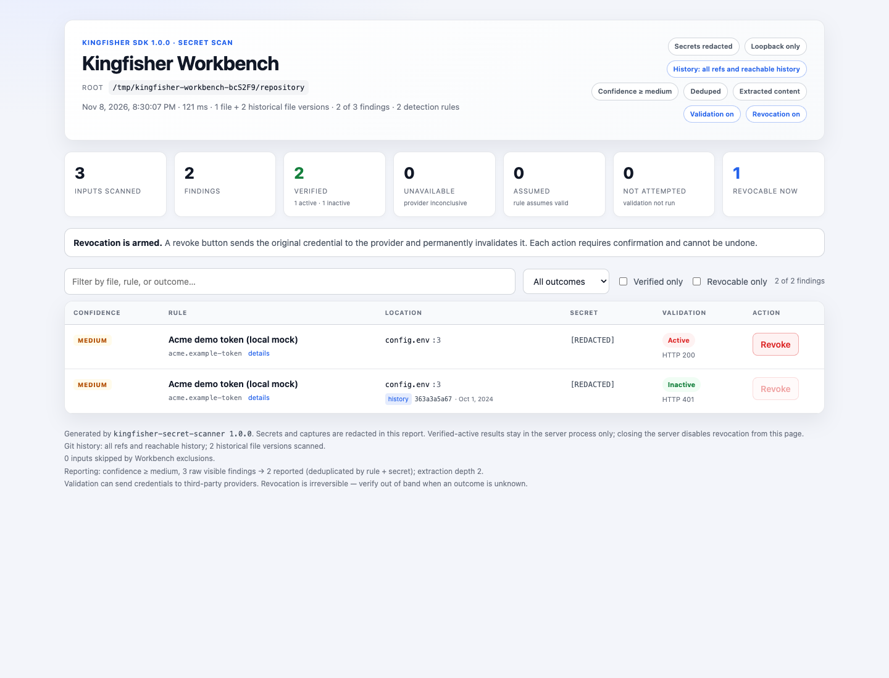

# Node SDK examples: run, inspect, adapt

These examples teach **in-process Node.js scanning**, not the Kingfisher CLI.
They use the public SDK API and work from the checkout before npm publication.
The distribution is `kingfisher-secret-scanner`; its stable version is **1.0.1**.

## Showcase: Kingfisher Workbench

[Kingfisher Workbench](kingfisher-workbench/README.md) is a complete, commented application:
scan a working tree and Git history, follow live progress, triage a redacted HTML
report, and explicitly validate or revoke supported credentials. It uses the SDK
in process, with no Kingfisher CLI dependency.



After building the checkout, run `node examples/kingfisher-workbench/scripts/checkout.mjs demo`
from `javascript/`. The demo creates a temporary Git repository, validates only
against a loopback mock, and leaves revocation to an explicit browser confirmation.
See its [walkthrough and safety notes](kingfisher-workbench/README.md) before adapting
it to real repositories.

## Instructions for humans and LLM agents

1. Choose **checkout mode** or **published-package mode** below. Do not mix their imports.
2. Start with `quickstart.mjs`; it uses synthetic, detection-only data and needs no account.
3. Read the selected example's comments, inputs, side effects, and expected output.
4. Run one recipe at a time. A successful empty result is not proof that all secrets were found.
5. Preserve original `Finding` / `ValidationResult` objects for later authorized operations.
   JSON is for reporting, not reconstructing a credential or authorizing revocation.
6. Do not send real credentials to a provider or revoke them without explicit authorization.
7. Keep reports redacted, propagate errors, and close native resources in `finally`.

**API reference:** [public declarations](../index.d.ts). **Concepts and integration
recipes:** [JavaScript/TypeScript guide](https://github.com/mongodb/kingfisher/blob/main/docs/JAVASCRIPT.md).
**Publishing:** [npm trusted-publishing guidance](https://github.com/mongodb/kingfisher/blob/main/docs/PUBLISHING.md#npm-publishing-with-github-actions).

## Setup A: run from the checkout now

**Working directory:** the repository's `javascript/` directory.
**Requirements:** Node **22, 24 or 26 only**, tested minimum **22.13.0**, plus
Rust 1.99 and the
[native build prerequisites](https://github.com/mongodb/kingfisher/blob/main/docs/LIBRARY.md#build-and-deployment).
First follow the canonical
[checkout build/test steps](https://github.com/mongodb/kingfisher/blob/main/CONTRIBUTING.md#javascripttypescript-sdk-development)
or [SDK build guide](https://github.com/mongodb/kingfisher/blob/main/docs/JAVASCRIPT.md#build-and-test-from-a-checkout),
then run:

```sh
node examples/quickstart.mjs
```

See the [platform guide](https://github.com/mongodb/kingfisher/blob/main/docs/JAVASCRIPT.md#nodejs-and-vs-code-support)
for the exact engines/CI matrix, Linux runtime and Windows VC++ Redistributable requirements.

The build writes the host `.node` file and generated private loader/declarations.
It does not publish anything. The examples' `../index.mjs` or `../index.cjs`
imports intentionally use this local SDK. The TypeScript example uses the package's
public self-reference, which also resolves inside this checkout.

## Setup B: adapt to an installed npm package after publication

**Working directory:** a new application directory, not the Kingfisher checkout.
**Requirements:** a supported Node runtime/platform and the published SDK.
Consumers receive native binaries and do **not** need Rust or a local Kingfisher install.

```sh
npm init -y
npm install kingfisher-secret-scanner@1.0.1 --ignore-scripts
```

Copy the chosen example **and its `fixtures/` dependencies**, preserving their
relative layout. Change `from '../index.mjs'` to
`from 'kingfisher-secret-scanner'`, or CommonJS
`require('../index.cjs')` to `require('kingfisher-secret-scanner')`.
Do not copy `_native.cjs` or build files into your application.
Use `.mjs` for ESM, `.cjs` for CommonJS, or your normal TypeScript compiler setup.

## Recipe selection

All commands below run from **`javascript/`** in checkout mode.

| Task | Runnable source and command | Side effects | Success signal |
| --- | --- | --- | --- |
| Scan text, bytes and one file | [quickstart.mjs](quickstart.mjs): `node examples/quickstart.mjs` | Local fixture reads only | Three JSON lines; one redacted finding per phase |
| Load/inspect YAML and TOML | [custom-rules.mjs](custom-rules.mjs): `node examples/custom-rules.mjs` | Local rule reads only | Two exact rule IDs, then two findings |
| Handle cancellation and caps | [controlled-scan.mjs](controlled-scan.mjs): `node examples/controlled-scan.mjs` | None | Cancellation/limit codes, then a successful scan |
| Scan a project as JSONL | [scan-project.mjs](scan-project.mjs): `node examples/scan-project.mjs` | Reads local fixture; transforms may use temporary storage | One redacted input/result record |
| Explicitly expand archives | [archive-content.mjs](archive-content.mjs): `node examples/archive-content.mjs` | Synthetic gzip; temporary extraction may occur | One member, preserved repository metadata, one finding |
| Select a local Git scope | [git-scopes.mjs](git-scopes.mjs): see commands below | Reads the repository; no fetch/checkout/writes | JSONL with selected commit/blob provenance |
| Prepare and validate selected original findings | [local-workflow.mjs](local-workflow.mjs): `node examples/local-workflow.mjs` | Loopback HTTP, owned temporary rule file; full batch retained for helpers | One validation request; zero revocations |
| Demonstrate explicit revocation | [local-workflow.mjs](local-workflow.mjs): `node examples/local-workflow.mjs --confirm-demo-revoke` | Changes only synthetic in-memory server state | One validation and one revocation; `active: false` |
| Use TypeScript types | [typed-scan.mts](typed-scan.mts): `node --experimental-strip-types examples/typed-scan.mts` after `npm run test:types` | Reads a teaching rule only | One typed, redacted input/result record |
| Scan a file with built-ins (CJS) | [content.cjs](content.cjs): `node examples/content.cjs examples/fixtures/project/config.env` | Reads one local file | Zero or more redacted built-in findings; no findings is success, not a coverage guarantee |
| Compose filesystem transforms (CJS) | [inputs.cjs](inputs.cjs): `node examples/inputs.cjs examples/fixtures/project` | Reads local paths; private extraction storage may be used | One JSON result per expanded input |
| Scan a Git snapshot (CJS) | [git.cjs](git.cjs): `node examples/git.cjs ..` | Reads local `HEAD`; no fetch/checkout | JSON results with snapshot provenance, up to the explicit 10,000-input cap |
| Inspect metadata, policy and controls | [rules-and-controls.mjs](rules-and-controls.mjs): `node examples/rules-and-controls.mjs` | Offline rule loading and detection | Catalog metadata, a caught `AbortError`, then redacted visible findings |
| Prepare trusted custom-rule operations (CJS) | [validate-revoke.cjs](validate-revoke.cjs): `node examples/validate-revoke.cjs company.yml config.env` | Local reads by default; live flags need separate authorization | Redacted plan; validation/analysis/revocation require the flags below |

## 1. Understand the quickstart output

The [teaching rule](fixtures/acme-token.yml) finds one synthetic token format.
It has **no validation or revocation**. It is not a real Acme detector.

The output is JSONL (one JSON object per line). Its essential fields look like:

```json
{"phase":"text","findings":[{"ruleId":"acme.example-token","visible":true,"secret":"[REDACTED]","location":{"startOffset":11,"endOffset":37,"line":1,"column":11}}]}
```

Actual reports include confidence, entropy, fingerprints and blob IDs too.
Do not assert fixed fingerprints, blob IDs, paths, ports or entropy formatting.
`startOffset`/`endOffset` are zero-based, end-exclusive **byte offsets**;
`line` is one-based and `column` is a zero-based byte column, not a JS string index.

To adapt the example:

- **Built-in catalog:** use `const rules = await Rules.load()` instead of the teaching rule.
- **Built-ins plus custom rules:** pass `paths` and omit `builtins: false`.
- **Unsaved editor buffer:** pass the document text to `scan()` with its logical path.
- **One stable local file:** use `scanFile()`. Snapshot a changing file yourself and use `scan()`.
- **Application-owned inputs:** construct `ScanInput` and use `scanInput()` / `scanInputs()`.

## 2. Load custom rules without losing their namespaces

`custom-rules.mjs` loads both supported formats using one `Rules.load()` call.
Its YAML ID remains `acme.example-token`; its TOML ID becomes
`custom.acme-example-toml`. `resolve()` returns exact IDs, not fuzzy guesses.
`metadata()` describes capabilities; `detail(exactId)` returns the trusted rule
definition. Neither makes provider requests.

Read [rule authoring](https://github.com/mongodb/kingfisher/blob/main/docs/RULES.md) before adapting patterns, captures,
entropy filters or validation. In particular, Betterleaks v2 uses expression
filters rather than Gitleaks' `entropy` rule field. Do not invent unsupported fields.

## 3. Control resources and distinguish failure from no matches

`controlled-scan.mjs` intentionally produces:

```json
{"phase":"cancelled","code":"ERR_KINGFISHER_CANCELLED"}
{"phase":"too-large","code":"ERR_KINGFISHER_LIMIT"}
{"phase":"completed","inputs":2,"findings":0}
```

In your application:

- Give each operation a positive `timeoutMs`; pass `signal` or `cancellation` to cancel work.
- A cancelled `CancellationToken` is permanent. Make a new token for a new operation.
- Bound submitted work. `maxPendingOperations` counts both queued and executing calls;
  unbounded `Promise.all()` can produce `ERR_KINGFISHER_BUSY`.
- Do not catch an error and return `[]`. Preserve failure/cancellation as a separate state.
- `close()` cancels and awaits pending work. Do not terminate a Node worker to cancel native code.
- These are cooperative controls, not a hard wall-clock or process-memory sandbox.
- Cancellation is `AbortError` / `ERR_KINGFISHER_CANCELLED`; timeout is `TimeoutError` /
  `ERR_KINGFISHER_TIMEOUT`. Submitted revocations may also set `outcomeUnknown: true`;
  interruption is not proof of no mutation, and unknown actions must not be retried blindly.

## 4. Stream a real project without mixing credential contexts

```sh
node examples/scan-project.mjs ../path-to-your-project
```

Pipeline: **enumerate → expand archives → extract supported content → detect → report**.
With paths supplied, the script loads the complete built-in catalog. With no
arguments, it uses only the teaching rule and synthetic fixture project.
The script honors local ignores, skips symlinks and `.git`, and prints one redacted
JSON object per input to **stdout**. Root input errors throw; recoverable nested
walk/ignore errors invoke `onWarning`, which writes structured warnings to **stderr**
and sets exit status **1** while readable inputs continue. Exit **0** means the
pipeline completed without those warnings, not a guarantee of finding every secret.
PDF extraction is off; enable `pdf: true` explicitly if needed. Press Ctrl+C to
signal all stages.

The iterator is lazy, but a complete archive root is expanded before its first
member is yielded. A root failure does not produce a successful partial root.
Earlier completed input reports may already have reached stdout when a later
input fails; inspect the process exit status before declaring a complete scan.
Temporary extracted plaintext can survive a crash; use an appropriately protected
`tempDir` parent if local staging is sensitive.

For later authorized validation, process **one result at a time**:

```js
for await (const result of scanner.scanInputs(inputs)) {
  const validated = await validator.validate(result.findings);
  // Filter only for reporting, after helpers have been used.
  for (const item of validated) {
    if (item.finding.visible) console.log(JSON.stringify(item.toJSON()));
  }
}
```

That fragment assumes initialized `scanner`, `inputs` and an authorized `validator`.
Do not combine findings from unrelated files or discard invisible helpers first.

## 5. Scan the correct Git scope

**Input:** an existing local repository root, not a URL. These commands read it only.
Replace `../my-repository` with its path; `HEAD~1` requires a parent commit.

```sh
node examples/git-scopes.mjs ../my-repository snapshot HEAD
node examples/git-scopes.mjs ../my-repository history HEAD
node examples/git-scopes.mjs ../my-repository diff HEAD HEAD~1
node examples/git-scopes.mjs ../my-repository staged
```

| Scope | Meaning |
| --- | --- |
| `snapshot` | Regular-file blobs at one selected ref; not unsaved or unstaged worktree edits |
| `history` | File versions/occurrences selected from reachable history, not only the current tree |
| `diff` | Target ref versus `sinceCommit`; not a scan of patch text alone |
| `staged` | Index content versus the default HEAD baseline; no unstaged edits or new commits |

`gitInputs()` defaults to history; the example makes its default **snapshot** explicit.
For all-ref history, use `refs: null`; for a recent history window, add
`sinceHours: 48` only to history mode. Time filters do not remove ancestry work.
`maxCommits` / `maxInputs` fail rather than silently truncate coverage.
Skipped oversized or missing blobs mean incomplete coverage: the script reports
warnings and exits **2**. Other failures exit **1**. Success exits **0**.
Missing blobs fail by default; the SDK never fetches them.

Provenance is preserved through transforms. A selected `commit` is not proof of
the first-ever introduction. Timestamps are decimal strings; emails/messages remain
sensitive even though ordinary JSON omits them.

## 6. Learn validation/revocation using only a local mock

```sh
node examples/local-workflow.mjs
node examples/local-workflow.mjs --confirm-demo-revoke
```

The complete script creates a server bound to **`127.0.0.1` only**, loads a
temporary teaching rule, and always removes its owned temporary directory.
Preparation/inspection make **zero** requests. Validation requires both a 200
response and `authenticated: true`. A 200 status alone is not enough.

Default final line:

```json
{"phase":"summary","requests":{"validation":1,"revocation":0},"active":true}
```

With `--confirm-demo-revoke`:

```json
{"phase":"summary","requests":{"validation":1,"revocation":1},"active":false}
```

`allowInternalIps: true` is limited to this mock. Do not copy that setting into
production without specific authorization. Real revocation needs the original
verified-active `ValidationResult`, `revocationReady: true`, and `confirm: true`.
JSON and `redacted()` copies are not replacements for private action snapshots.
Do not automatically retry an unknown submitted mutation.

## 7. Use a real provider only after separate authorization

The existing [validate-revoke.cjs](validate-revoke.cjs) accepts a **trusted custom
rules file** and a **local credential-containing file**. Its default is offline preparation:

```sh
node examples/validate-revoke.cjs company.yml config.env
```

Only after confirming the selected rule's credential destinations and authorization:

```sh
node examples/validate-revoke.cjs company.yml config.env --validate
```

`--analyze` is an additional explicit provider-analysis operation and also requires
`--validate`. `--confirm-revoke` authorizes credential mutation and must accompany
`--validate`; only original verified-active results with `revocationReady: true`
are eligible. Never add that flag merely to “test” an integration. Existing YAML/TOML rules need
no edits. HTTP fallbacks remain opt-in; validation/revocation reuse are independent,
and revocation executes only the original selected action without mutation failover.

## 8. Type-check before running TypeScript

From `javascript/`, with supported Node **22 (22.13.0+), 24 or 26**:

```sh
npm run test:types
node --experimental-strip-types examples/typed-scan.mts
```

The flag runs this erasable-syntax teaching example; it is **not** a TypeScript
type checker. Use your application's compiler/bundler for production and keep the
native package external. See the [complete TypeScript consumer recipe](https://github.com/mongodb/kingfisher/blob/main/docs/JAVASCRIPT.md#typescript-application).

## Verification

```sh
npm test
npm run test:types
```

`tests/examples.test.cjs` runs these recipes, checks redaction, exercises all four
Git scopes in an owned fixture, and confines network/mutation tests to the local mock.
It does not publish npm packages or send real credentials to providers.
